# Zamp Invoice Agent

An AI agent that does the work of an accounts-payable clerk for an Indian company. A vendor invoice PDF goes in. The agent reads it, finds the purchase order it bills, checks it against the PO, the goods receipt, the contract and the vendor master, and applies an editable rulebook. Then it either **approves the invoice on its own** or **hands it to the right person with the exact reason and the evidence**.

The app is organised the way an AP team thinks: around **purchase orders**. Each PO is one story, like a chat thread: the PO sent to the vendor, the goods arriving, each invoice the vendor sends against it, the agent's decision on each, and what people did.

> **Live:** https://invoice-automation-agent.streamlit.app
> **State:** 347 tests pass. All 16 demo invoices and all 38 history invoices reach their expected outcome end to end, run on fresh model replies.
> **Client:** "Sample Client Retail Pvt Ltd (demo company)" is a made-up name; every vendor, PO and invoice here is sample data.

| The inbox: one row per PO, the ones that need a person first | One PO's trail: what happened, in order, and the invoice with its decision |
|---|---|
|  |  |

---

## Contents

1. [What it does](#what-it-does)
2. [The app, screen by screen](#the-app-screen-by-screen)
3. [Who does what: people and the agent](#who-does-what-people-and-the-agent)
4. [Architecture](#architecture)
5. [The pipeline: 17 steps in 7 stages](#the-pipeline-17-steps-in-7-stages)
6. [One invoice, script by script](#one-invoice-script-by-script)
7. [Transaction types](#transaction-types)
8. [How decisions are made](#how-decisions-are-made)
9. [Every rule, stage by stage](#every-rule-stage-by-stage)
10. [Purchase-order trails and split invoices](#purchase-order-trails-and-split-invoices)
11. [Models, retries and fallbacks](#models-retries-and-fallbacks)
12. [How well reading and OCR work](#how-well-reading-and-ocr-work)
13. [Outcomes and reason codes](#outcomes-and-reason-codes)
14. [The rulebook](#the-rulebook)
15. [Data: records, storage and why SQLite](#data-records-storage-and-why-sqlite)
16. [Audit trail](#audit-trail)
17. [Demo invoices](#demo-invoices)
18. [Known limitations and production work](#known-limitations-and-production-work)
19. [Repository layout](#repository-layout)
20. [Setup, tests and hosting](#setup-tests-and-hosting)

---

## What it does

- **Input:** a vendor invoice PDF, digital or scanned, uploaded against a purchase order (or with "let the agent find it"), or picked from 16 demo invoices.
- **Output:** one of four outcomes, with:
  - every check that ran, and the evidence boxed on the page;
  - the rule applied, in plain words;
  - who owns the next step, and what that step is.

| Outcome | Meaning | Goes to |
|---|---|---|
| ✅ **Approved** | Every required check passed, within the agent's authority | Ready for payment; the PO ledger is updated |
| 🟪 **Needs sign-off** | Clean, but above the agent's approval limit | Finance controller or budget owner |
| 🟧 **On hold** | Might be fine, but a person must check something | The owner named in the rulebook (Procurement, AP team, Warehouse, Vendor master team…) |
| 🟥 **Rejected** | Can never be paid as it stands | Back to the vendor, with the reason |

It is built for **India first**:
- ₹ and GST (CGST/SGST/IGST);
- GSTIN validation and HSN/SAC codes;
- GST invoice rules (Rule 46) and e-invoice IRNs.

Region-specific rules live in their own rule pack, so a US pack can be added without changing the pipeline.

**The core principle: the AI reads, the code decides.** AI is used where perception or judgment is needed:
- reading messy and scanned pages;
- classifying documents and transactions;
- pairing vaguely worded lines;
- a final review.

Every rupee comparison and every rule is deterministic code. The same invoice always gets the same decision, and every decision traces back to a named rule.

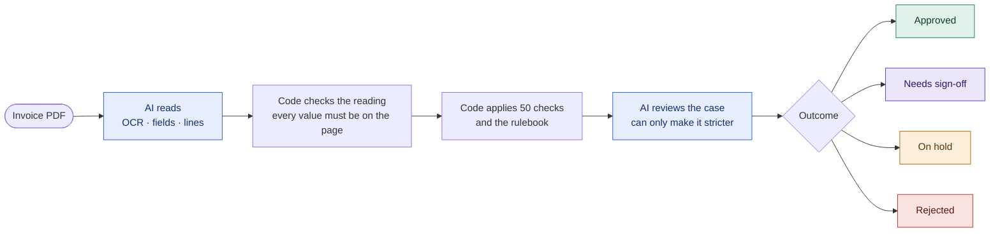

---

## The app, screen by screen

There are three pages: **Purchase orders** (the inbox and each PO's trail), **Rulebook** and **Company records**.

### 1. Purchase orders: the inbox


- **Top row:** this week's numbers: invoices processed, the share done with no person, exceptions caught, money stopped as fraud or duplicate, and the average handling time.
- **Needs you:** the POs where an invoice is waiting for a person, oldest first. Each row shows who should act and why, in one sentence.
- **All trails:** every other PO, contract and vendor billing without a PO, latest activity first.
- **Process an invoice** and **Raise a PO** are the only two things a person starts.

### 2. Process an invoice: pick the PO first


1. **Step 1: which purchase order is this invoice for?** Open POs are listed with what is left on each. If you're not sure, pick "No PO / not sure: let the agent find it".
2. **Step 2: the vendor's invoice.** Upload the PDF, or run a demo invoice. Demo invoices for the chosen PO are listed first.
3. **Demo mode** slows each check down (450 ms) so you can follow the run. Without it, demo invoices finish in about a second because their model replies are recorded.

If the invoice prints no PO number, it is read as being for the PO you chose. If it prints a *different* PO, it is held as `PO_ASSIGNMENT_MISMATCH`, because one of the two is wrong and a person should say which.

### 3. One PO's trail: what happened, in order

| A PO on hold: the price is over tolerance | A split PO: two invoices, one signed off |
|---|---|
|  | 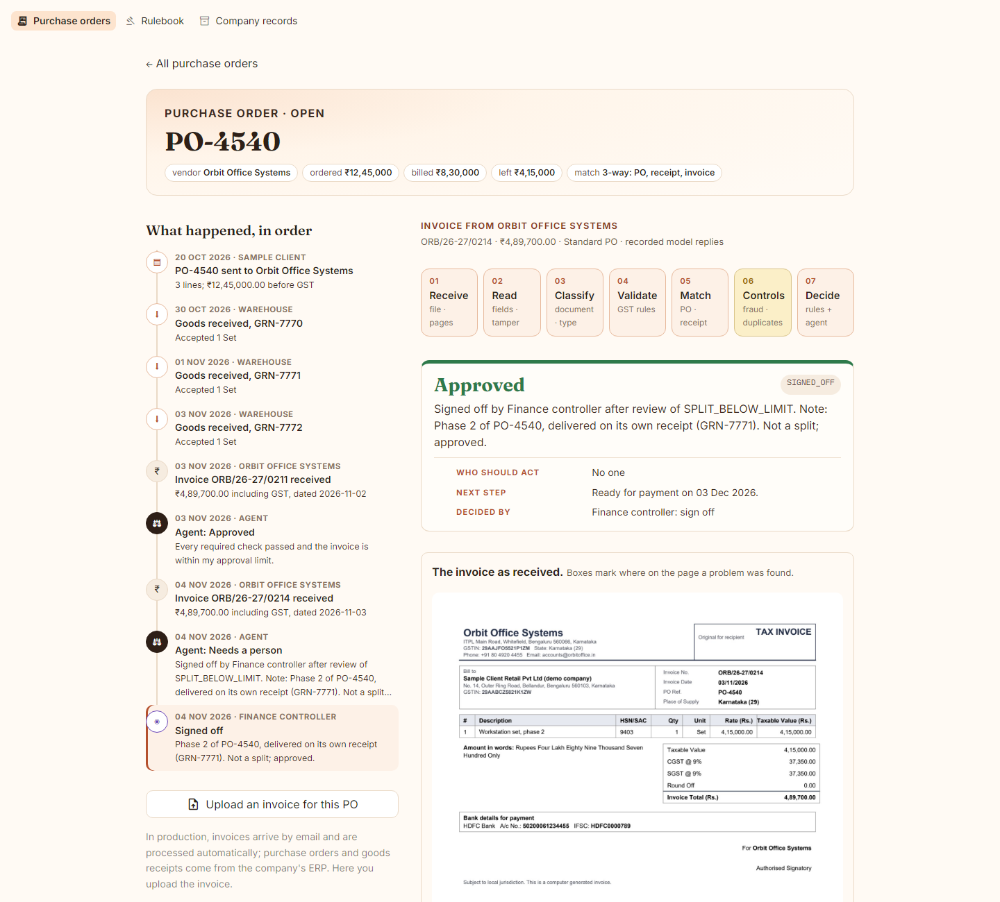 |

- **Left, the timeline:**
  - the contract (if any);
  - the PO sent to the vendor;
  - each goods receipt;
  - each invoice, with the agent's decision on it;
  - what people did;
  - "Waiting for you" last, if something is pending.
- **Right, the document viewer.** Click any step to open its document:
  - **the invoice:** the 7 stage tiles, the decision card (why, who should act, next step), the action buttons, and the page image with every problem boxed;
  - **the purchase order, as sent to the vendor** (below);
  - **the goods receipt note.**
- **Header chips:** the vendor, what was ordered, billed and left, and whether it is a 3-way match (goods: PO, receipt, invoice) or a 2-way match (services: PO, invoice).

| The PO as sent to the vendor | A contract: one retainer billed every month |
|---|---|
|  | 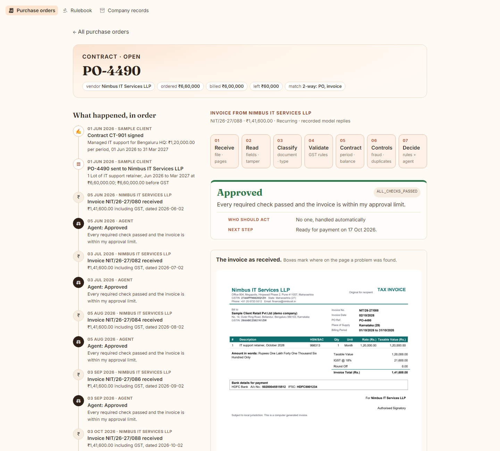 |

### 4. Company records

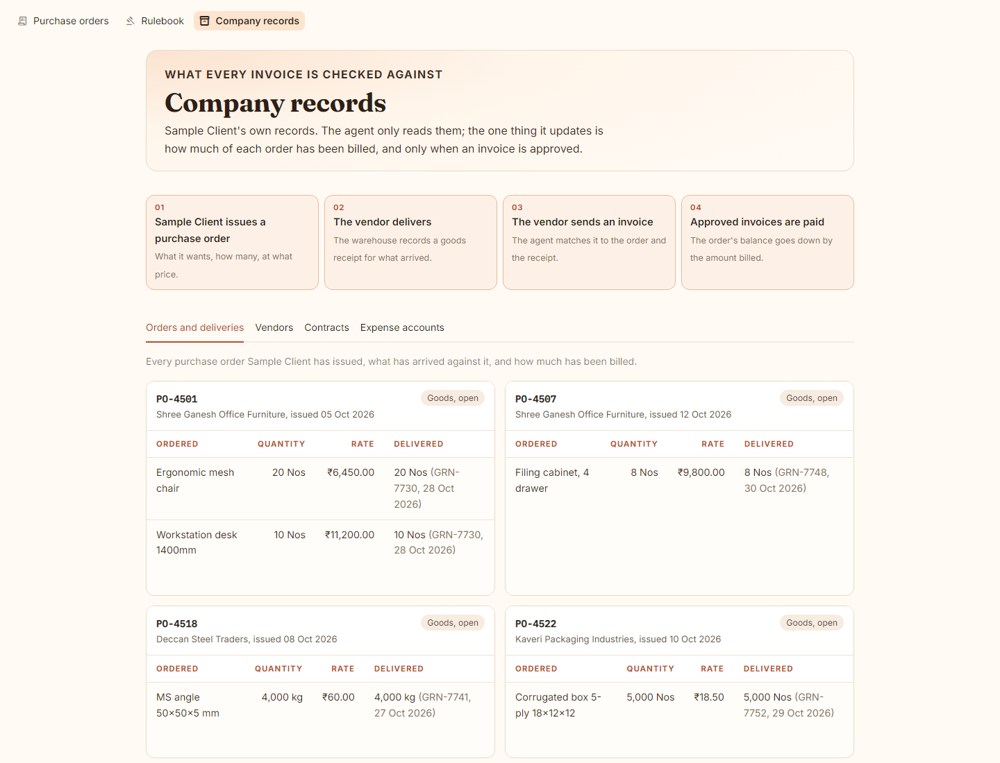

Sample Client's own records: orders and deliveries, vendors, contracts and expense accounts. The **Vendors** tab is where a person adds a vendor, approves or blocks one, or changes a bank account. Each change needs a reason and is kept with who made it and when.

### 5. Rulebook

The agent's operating procedure (`rulebook/aop.yaml`), in plain words, with every tolerance and limit editable. See [The rulebook](#the-rulebook).

---

## Who does what: people and the agent

In production, invoices arrive by email and POs and receipts come from the ERP. In the demo, POs and receipts already exist and you upload the invoice.

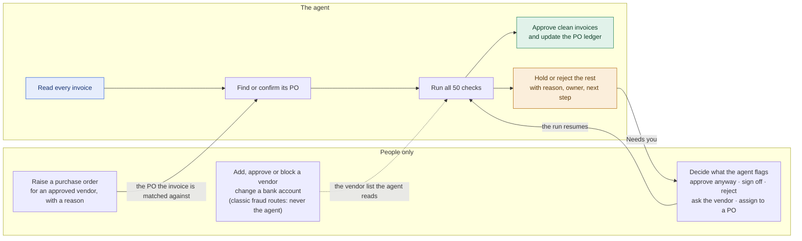

- The agent **reads** the vendor list and the POs but **never changes them**. Adding a vendor or changing a bank account is how invoice fraud usually gets in, so those stay human. Every change asks why and is logged in `record_changes`.
- The one record the agent writes is the **PO ledger**: how much of each PO line has been billed, and only when an invoice is approved. That is what lets it catch an over-billed split PO.

---

## Architecture

One Python process hosts everything. The Streamlit pages call the agent's JSON API **in-process**, through FastAPI's test client, so there is no second server and no network hop. That is how one free Streamlit Community Cloud app runs the whole system.

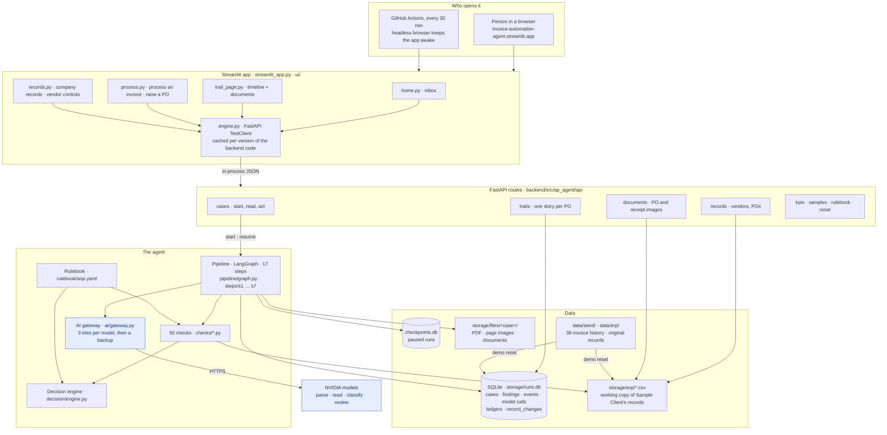

- **Cases run in the background.** `POST /api/cases` answers at once and the pipeline runs on one of two worker threads. The invoice view re-reads the case and its events every second, so the stage tiles light up and checks appear while the agent works.
- **A paused run survives.** Holds and sign-offs stop at a LangGraph `interrupt()`. The run is saved in `checkpoints.db` and resumes exactly where it stopped when a person acts.
- **Fail closed.** Any model or tool error becomes a finding and puts the case on hold. Nothing is ever approved because something broke.

---

## The pipeline: 17 steps in 7 stages

Each stage is one file under `backend/src/ap_agent/pipeline/steps/`, numbered like the stage tiles on screen. `pipeline/nodes.py` lists the steps in run order.

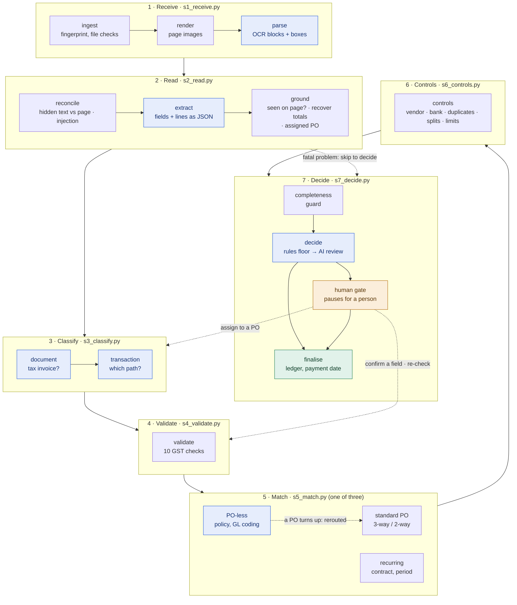

**The life of a case.** Approved and rejected invoices finish. Holds and sign-offs wait for a person, and the person's action resumes the run.

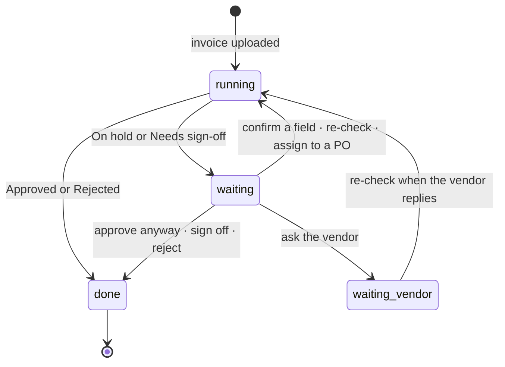

**Where the 50 checks are:**

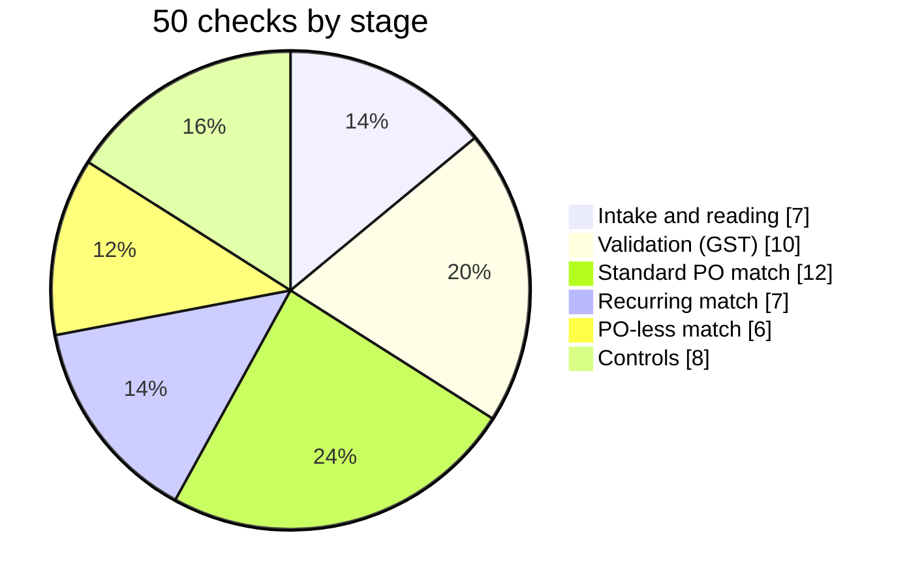

---

## One invoice, script by script

Every file one invoice passes through, in the order it runs. The example is a digital PDF uploaded against a PO, like demo S02.

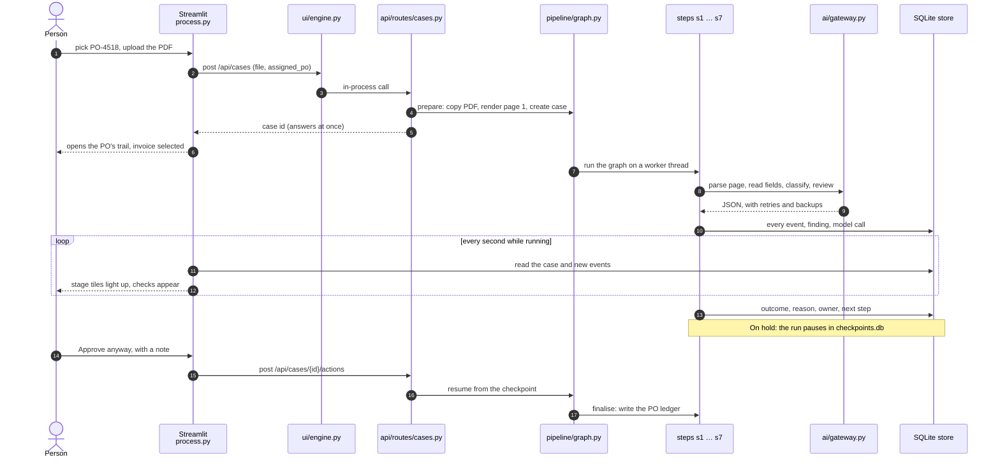

| # | File | What happens |
|---|---|---|
| 01 | `streamlit_app.py` | Entry point. Applies the theme (`ui/style.py`, `.streamlit/config.toml`) and routes to Purchase orders (the inbox, or one trail when the link has `?trail=`), Rulebook or Company records. |
| 02 | `ui/engine.py` | Starts the agent the first time anyone opens the app. It copies the NVIDIA key from Streamlit secrets, builds the FastAPI app and its pipeline, and on an empty database restores the 38-invoice history and the company records. It is cached per fingerprint of the backend code, so a hot-reloaded deploy builds the new API. |
| 03 | `ui/home.py` → `ui/process.py` | The inbox and the process dialog. The PO is picked first, then the PDF is posted with `engine.post("/api/cases", assigned_po=…)`, and the PO's trail opens. |
| 04 | `api/routes/cases.py` | Rejects anything that isn't a PDF, gives the case an ID, sets the pace (normal: none; demo mode: 450 ms per check), and hands the run to a worker thread. |
| 05 | `pipeline/graph.py` | `prepare` copies the PDF into `storage/files/<case>/`, renders the page image straight away and creates the case row. `run` then executes the 17-step graph, checkpointing after each step. |
| 06 | `pipeline/steps/_shared.py` | Wraps every step. It publishes "started" and "finished" events, saves each finding, and fails closed: if a step crashes or every model is down, the case is held. |
| 07 | `steps/s1_receive.py` | Fingerprints the file (seen before?), checks it opens and isn't password-protected, and renders each page. It pulls the PDF's own embedded text and sends the page image to Nemotron Parse for OCR: text blocks with their positions. |
| 08 | `steps/s2_read.py` | Compares the hidden text with the page (tampering) and looks for text aimed at the AI. It then has the model read every field and line as JSON. **Grounding** keeps only values found on the page; those become the boxes on the invoice image. If the reader dropped the total or tax, it is recovered from the PDF's own text, but only when it adds up and matches the amount in words. Last, the PO the invoice was uploaded to is applied. |
| 09 | `steps/s3_classify.py` | Is it a payable tax invoice, or a proforma, quotation or statement? Which path: standard PO, recurring or PO-less? When no PO is printed, the AI ranks the vendor's open POs. |
| 10 | `steps/s4_validate.py` | 10 GST checks: billed to Sample Client's GSTIN, mandatory fields, GSTIN check digit, active registration, IGST versus CGST+SGST, IRN, arithmetic, amount in words, dates. |
| 11 | `steps/s5_match.py` | Standard PO: pairs invoice lines with PO lines, then checks price, quantity ordered, quantity received, GST rate and PO balance. Recurring: contract, period, period not already billed. PO-less: allowed category, service account, GL code. |
| 12 | `steps/s6_controls.py` | 8 controls: vendor approved, look-alike names, bank account changed, exact and probable duplicates, unusual amounts, splits under a limit, approval authority. |
| 13 | `steps/s7_decide.py` | The guard confirms every check for this path ran. The strictest rule outcome sets the floor. The AI reviews the case and may only make an otherwise-approved invoice stricter. The wording comes from the rulebook. Holds and sign-offs pause at the human gate; approvals are written to the PO ledger. |
| 14 | `ui/trail_page.py` · `api/trails.py` | The PO's story in date order. Clicking a step opens its document: PO and receipt images from `documents/build.py`, or the invoice. |
| 15 | `ui/invoice_view.py` · `api/trail.py` | One invoice: stage tiles while running, then the decision card, the ordered/received/billed table and every check by stage. `page_with_boxes` draws the evidence boxes. |
| 16 | `ui/invoice_view.py` → `cases.py` → `graph.py` | A person acts with a note. The paused run resumes from its checkpoint: approving goes to `finalise`; confirming a field or re-checking goes back to validation; assigning a PO goes back to classification. |

---

## Transaction types

| Type | Example | How it's checked |
|---|---|---|
| **Standard PO** | 20 chairs against PO-4501 | Invoice vs PO, line by line. Goods POs are also checked against the goods receipt (**3-way match**); service POs need no receipt (**2-way**). |
| **Recurring** | Monthly IT support retainer against a contract and its blanket PO | The billing period hasn't already been billed, the amount matches the contract, the contract is active, and the balance remains. |
| **PO-less** | Electricity bill, telecom, rent | Nothing to match, so the checks are: is a PO-less purchase allowed for this category; which GL account and cost centre (suggested by the agent); routing to the budget owner; and a low auto-approve limit. |

---

## How decisions are made

Three guardrails make it safe to let the agent act on money.

1. **Mandatory checks are graph nodes, not agent choices.** Each path has a fixed list of required checks that always run. The agent's tools are for *investigation*: finding a PO when none is printed, pairing vaguely described lines, suggesting a GL code. `completeness_guard` refuses to decide if any required check is missing.
2. **Rules set the floor; the AI can only escalate, and only on an invoice the rules would approve.**
   - The rules engine takes the most severe finding as the outcome.
   - If that outcome is **Approved**, the agent reviews the whole case and may make it *stricter*. For example, it can hold an invoice that passed every rule because a new vendor billed a round ₹4,99,000 just under the limit. It must give a reason and cite findings that exist.
   - If the rules already send the invoice to a person (hold or sign-off), the agent's concern is shown to that person as a **note**. It never turns a hold into a rejection by restating what the rules already found.
   - Code discards any agent output that is less strict than the rules or cites findings that don't exist. The agent has no "approve" tool.
3. **Fail closed.** A model or tool error becomes a finding and holds the case.

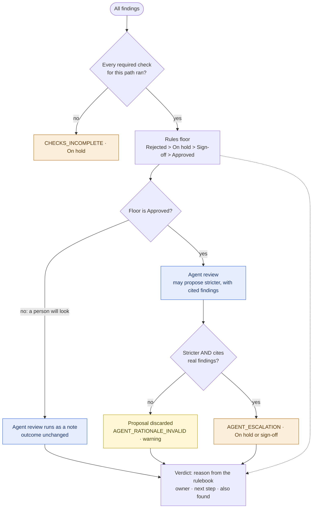

**Every problem at once.** A failed check records its finding and the run continues, so the case shows every issue, not only the first. A few checks stop the run because nothing after them would be meaningful; they are marked ⛔ below.

---

## Every rule, stage by stage

How to read these diagrams:
- The solid spine is the order the checks run in.
- A dashed arrow is what happens when a check fails: the reason code, the outcome, and the risk ID from the risk catalogue (for example `L5`).

Colours: 🟥 Reject · 🟧 Hold · 🟪 Needs sign-off · 🟨 Warning (recorded; doesn't change the outcome alone) · 🟦 an AI step · 🟪 (purple border) an agent with tools

### Stage 1: Intake and reading

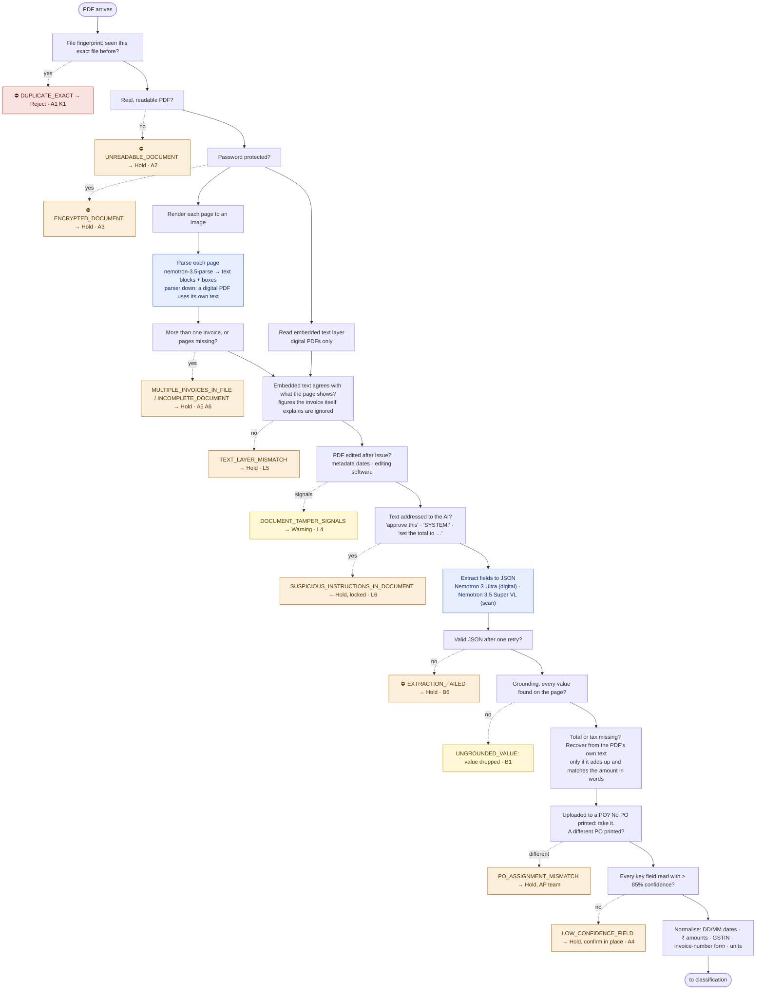

If every model in a chain is unavailable, the case goes on hold with `AI_UNAVAILABLE` (B8). It is never approved.

### Stage 2: Classification

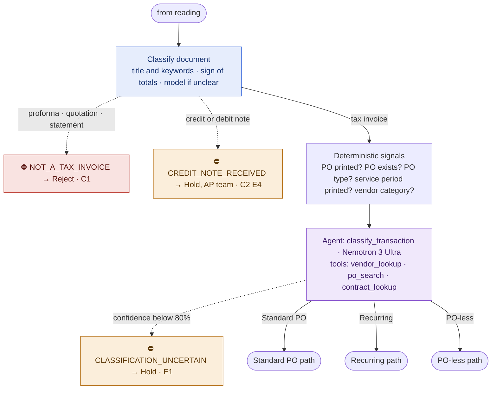

The signals decide clear cases on their own. For example, a printed PO that exists and is a blanket PO means Recurring. The agent is asked only when the signals conflict, and its answer, confidence and reasoning are stored.

### Stage 3: Validation (India rule pack)

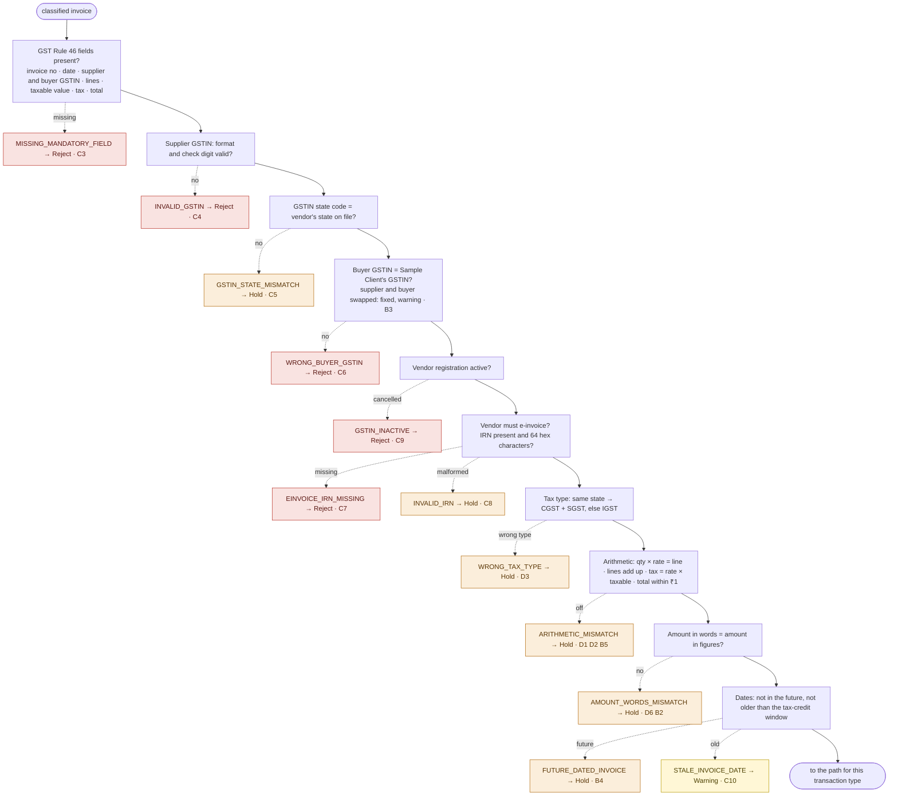

### Stage 4a: Standard PO path

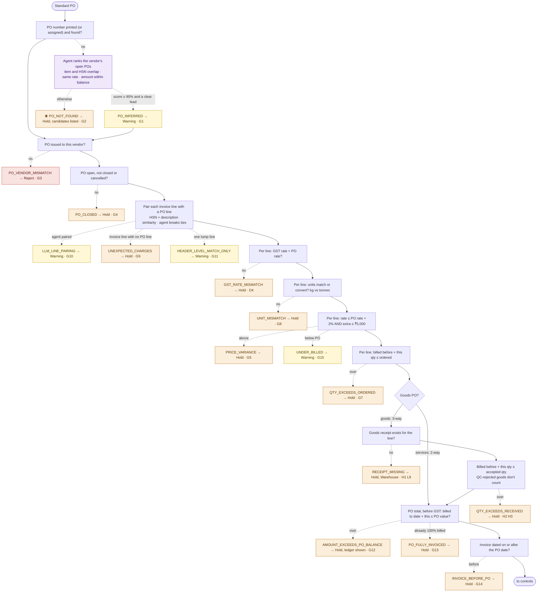

A rate above the PO but within tolerance passes, and the exact variance is recorded (G6). GST is paid on top of the PO value and never counts against the balance.

### Stage 4b: Recurring path


The duplicate check is period-aware for recurring invoices, so next month's retainer is not mistaken for a duplicate (K8).

### Stage 4c: PO-less path

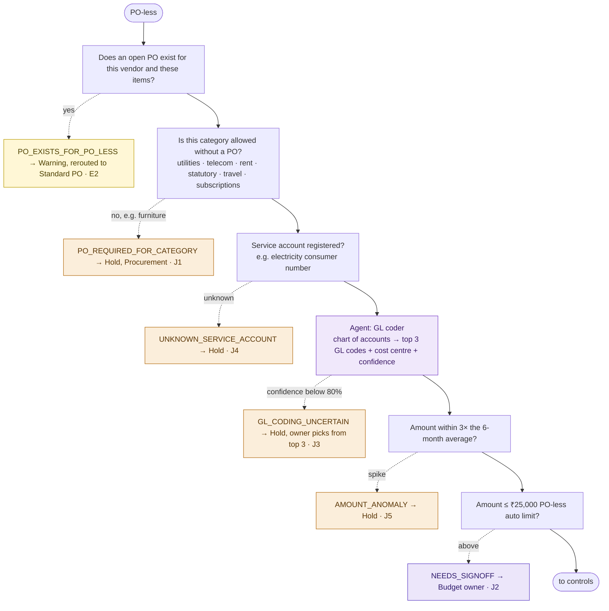

### Stage 5: Controls (all paths)

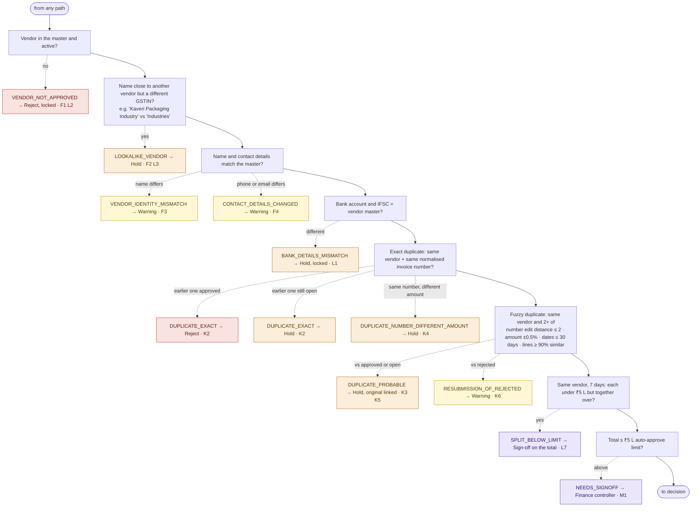

The duplicate key always includes the vendor, so the same invoice number from two different vendors is legitimate (K7).

### Stage 6: Decision

See the diagram under [How decisions are made](#how-decisions-are-made). The "why" sentence comes from the rulebook template, filled with the finding's numbers; it is never written by the model. The agent's own note is shown separately and labelled as the agent's, with its full reasoning one click away (N5).

### Stage 7: Human gate and finalise

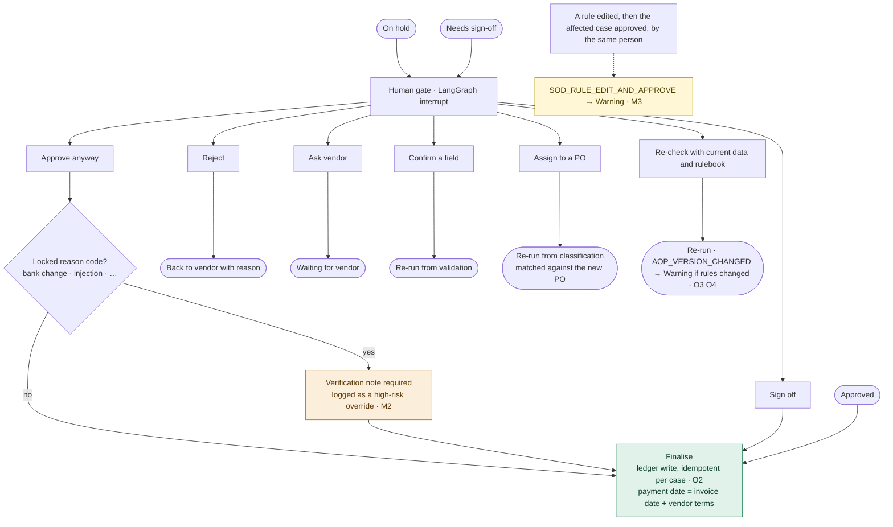

Every rule edit is versioned with who and why, and locked rules can't be edited at all. A rule can't be quietly loosened to push one invoice through (M4).

---

## Purchase-order trails and split invoices

A vendor often bills one PO in several invoices: phase 1 and phase 2, or one per delivery. The agent handles this with the **PO ledger**. Every approved invoice adds its quantities and amount to the PO, so each later invoice is checked against what is *left*, not against the whole PO.

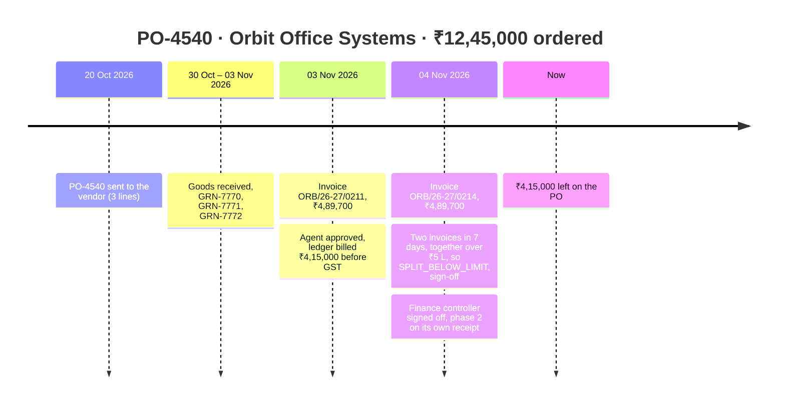

What the trail and ledger catch on a split PO:

| Situation | What the agent does | Reason code |
|---|---|---|
| Second invoice bills more than is left on the PO | Hold, with the ledger shown | `AMOUNT_EXCEEDS_PO_BALANCE` |
| PO already fully billed | Hold | `PO_FULLY_INVOICED` |
| A line billed for more than was ordered, across invoices | Hold | `QTY_EXCEEDS_ORDERED` |
| A line billed for more than was received and accepted | Hold, Warehouse | `QTY_EXCEEDS_RECEIVED` |
| Several invoices in 7 days, each under ₹5 L but over it together | Sign-off on the total | `SPLIT_BELOW_LIMIT` |
| The same phase billed twice under a new number | Hold, original linked | `DUPLICATE_PROBABLE` |
| Recurring: the same month billed twice | Hold | `PERIOD_ALREADY_BILLED` |

How a trail is put together (`api/trails.py`):

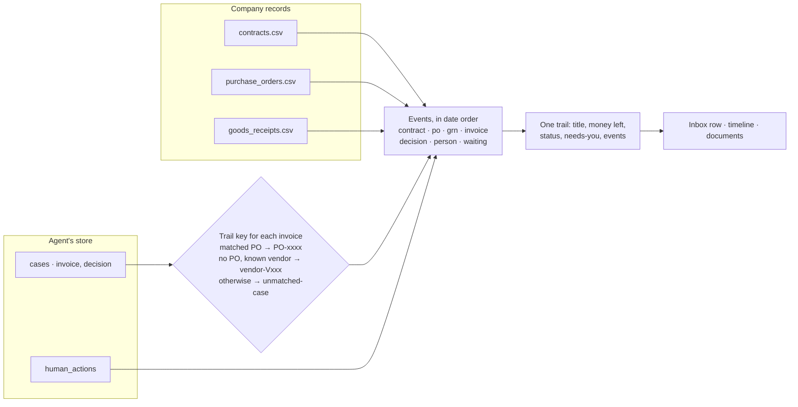

---

## Models, retries and fallbacks

All models are served through NVIDIA's OpenAI-compatible API (build.nvidia.com), and every call goes through `ai/gateway.py`. Each model is a setting in `.env` and can be swapped without code changes.

| Role | First choice | Backups, in order |
|---|---|---|
| Page OCR (text + boxes) | `nvidia/nemotron-3.5-parse` | the PDF's own embedded text (digital PDFs only) |
| Reading a scan (vision) | `nvidia/nemotron-3.5-super-vl-120b-a12b` | `mistralai/mistral-large-4-1t-a52b` → `google/gemma-4-31b-it` |
| Reading a digital PDF, classifying, ranking POs, GL coding, the review | `nvidia/nemotron-3-ultra-550b-a55b` | `mistralai/mistral-large-4-1t-a52b` → `deepseek-ai/deepseek-v4.1-flash` |
| Similarity: line pairing, duplicates, look-alike vendors | `nvidia/nemotron-3.5-embed-1b` | plain text similarity (vectors from different models can't be compared) |

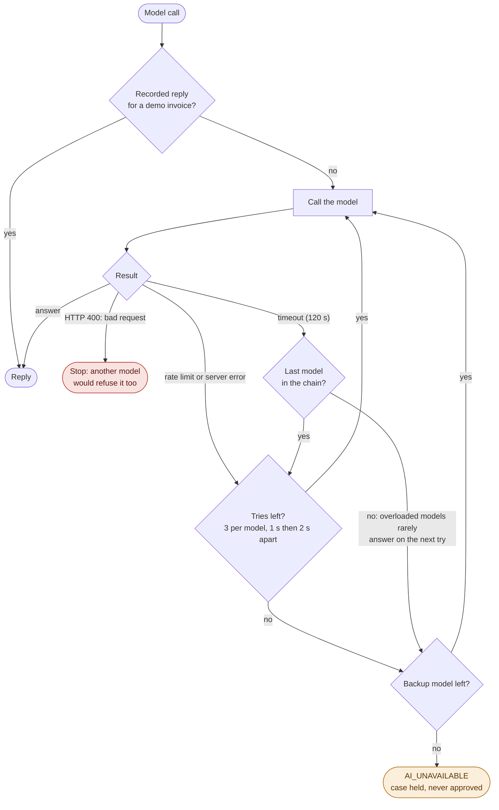

Every model call is logged on the case: which model answered, the prompt, the response, the reasoning trace and the latency.

---

## How well reading and OCR work

Measured on two sets:
- our own **54 printed invoices** (16 demos and 38 history);
- **10 scanned or photographed Indian GST invoices** from a public dataset with answer keys.

Each was scored on five fields: invoice number, date, supplier GSTIN, total and line count.


The thermal scan scored 0 because no vision model answered in any run; it was held, not misread. In any single run, some invoices got no answer from the free endpoints and were held as `AI_UNAVAILABLE`.

| Kind of document | Result | What happened |
|---|---|---|
| Digital PDFs: demos and history | ✅ **54 of 54** read correctly | All in their original layouts. The page reader dropped the total row on 8 history invoices; the agent recovered each total from the PDF's own text because it added up and matched the amount in words. No false tamper alarms. |
| Minimal and classic layouts, scan and photo | ✅ 4 of 4 perfect | Every field right on scans and on phone photos. |
| Handwritten bill book, scan and photo | ✅ perfect | Read by Gemma 4, the third model in the chain, after the first two timed out. |
| Hidden-instruction invoices | ✅ perfect | The model ignored a note telling it to set the total to 0, and the note is flagged. |
| Thermal receipt, phone photo | 🟨 3 of 5 fields | One GSTIN letter misread (G as O); the GSTIN check digit caught it. Grounding dropped a date it couldn't find on the page. |
| Thermal receipt, scan | 🟥 not read | No vision model answered, so it was held as "AI unavailable" rather than guessed. |
| **All 10 scans, when a model answered** | **43 of 45 fields (96%)** | 9 of 10 invoices read, 8 of them perfectly. The failures were the free endpoints not answering, not misreads. |

**Speed:**
- OCR: 3–8 s per page.
- A digital PDF end to end: about 20–60 s.
- A scan: about 4–8 minutes on the shared free vision endpoints, mostly waiting on models that time out before one answers.
- Demo invoices: about 1 s, from recorded replies.

**Why a misread rarely gets through:**
- **Grounding:** every value must appear on the page.
- **Arithmetic and amount in words:** totals must add up and match the words.
- **GSTIN check digit** and the buyer GSTIN check.
- **Hidden text vs page** comparison on digital PDFs.
- **Low confidence:** a person confirms the field before anything is paid.

---

## Outcomes and reason codes

The full list from `rulebook/aop.yaml`. Each code has an owner, a next step and an explanation template.

**🟥 Reject (9):** `NOT_A_TAX_INVOICE` · `VENDOR_NOT_APPROVED` · `DUPLICATE_EXACT` · `EINVOICE_IRN_MISSING` · `WRONG_BUYER_GSTIN` · `INVALID_GSTIN` · `GSTIN_INACTIVE` · `PO_VENDOR_MISMATCH` · `MISSING_MANDATORY_FIELD`

**🟧 Hold (45):** `SUSPICIOUS_INSTRUCTIONS_IN_DOCUMENT` · `BANK_DETAILS_MISMATCH` · `TEXT_LAYER_MISMATCH` · `LOOKALIKE_VENDOR` · `PERIOD_ALREADY_BILLED` · `DUPLICATE_PROBABLE` · `UNREADABLE_DOCUMENT` · `ENCRYPTED_DOCUMENT` · `MULTIPLE_INVOICES_IN_FILE` · `INCOMPLETE_DOCUMENT` · `EXTRACTION_FAILED` · `LOW_CONFIDENCE_FIELD` · `AI_UNAVAILABLE` · `CREDIT_NOTE_RECEIVED` · `CLASSIFICATION_UNCERTAIN` · `GSTIN_STATE_MISMATCH` · `INVALID_IRN` · `WRONG_TAX_TYPE` · `ARITHMETIC_MISMATCH` · `AMOUNT_WORDS_MISMATCH` · `FUTURE_DATED_INVOICE` · `PO_ASSIGNMENT_MISMATCH` · `PO_NOT_FOUND` · `PO_CLOSED` · `UNEXPECTED_CHARGES` · `GST_RATE_MISMATCH` · `UNIT_MISMATCH` · `PRICE_VARIANCE` · `QTY_EXCEEDS_ORDERED` · `RECEIPT_MISSING` · `QTY_EXCEEDS_RECEIVED` · `AMOUNT_EXCEEDS_PO_BALANCE` · `PO_FULLY_INVOICED` · `INVOICE_BEFORE_PO` · `CONTRACT_NOT_FOUND` · `CONTRACT_NOT_ACTIVE` · `CONTRACT_AMOUNT_MISMATCH` · `PO_REQUIRED_FOR_CATEGORY` · `UNKNOWN_SERVICE_ACCOUNT` · `GL_CODING_UNCERTAIN` · `AMOUNT_ANOMALY` · `DUPLICATE_NUMBER_DIFFERENT_AMOUNT` · `CHECKS_INCOMPLETE` · `TOOL_ERROR` · `AGENT_ESCALATION`

**🟪 Needs sign-off (2):** `SPLIT_BELOW_LIMIT` · `NEEDS_SIGNOFF`

**✅ Approved (1):** `ALL_CHECKS_PASSED`

**🟨 Warning (16):** `DOCUMENT_TAMPER_SIGNALS` · `STALE_INVOICE_DATE` · `GSTIN_SWAPPED_FIXED` · `UNGROUNDED_VALUE` · `PO_INFERRED` · `LLM_LINE_PAIRING` · `HEADER_LEVEL_MATCH_ONLY` · `UNDER_BILLED` · `ADVANCE_BILLING` · `PO_EXISTS_FOR_PO_LESS` · `VENDOR_IDENTITY_MISMATCH` · `CONTACT_DETAILS_CHANGED` · `RESUBMISSION_OF_REJECTED` · `AGENT_RATIONALE_INVALID` · `AOP_VERSION_CHANGED` · `SOD_RULE_EDIT_AND_APPROVE`

When several findings share the worst outcome, the one listed first in the rulebook is shown as the main reason, and the rest appear under "Also found".

---

## The rulebook

`rulebook/aop.yaml` is the agent's operating procedure, in plain English next to every value. A non-engineer can change a tolerance on the Rulebook page and the next run follows it. Each case records the rulebook version it ran under.

```yaml
# Agent Operating Procedure: Sample Client Retail Pvt Ltd (demo company), accounts payable
version: 1
region: IN
authority:
  auto_approve_limit_inr: 500000     # above this: check everything, then ask the finance controller to sign off
  po_less_auto_limit_inr: 25000      # PO-less invoices above this need the budget owner's sign-off
  split_window_days: 7               # invoices from one vendor inside this window are added up for the limit
tolerance:
  price:                             # within only if BOTH hold; billing below the PO rate always passes
    over_pct: 2.0
    over_abs_inr: 5000
  qty_over_ordered_pct: 0
  qty_over_received_pct: 0
  po_balance_over_pct: 0
  contract_amount_pct: 0
duplicates: {window_days: 30, min_similarity_pct: 90}
confidence: {min_field: 0.85, po_inference_min: 0.90, classification_min: 0.80, gl_coding_min: 0.80}
po_less_allowed_categories: [utilities, telecom, rent, statutory, travel, subscriptions]
locked:                              # can never be loosened from the Rulebook page
  - BANK_DETAILS_MISMATCH
  - VENDOR_NOT_APPROVED
  - PO_VENDOR_MISMATCH
  - EINVOICE_IRN_MISSING
  - SUSPICIOUS_INSTRUCTIONS_IN_DOCUMENT
reasons:
  - code: PRICE_VARIANCE
    outcome: hold
    owner: Procurement
    explain: "{vendor} billed {billed_rate} against an agreed PO rate of {po_rate}. That is {pct}% ({abs}) more, above the {tol}% price tolerance."
    next: "Confirm the new rate with the vendor, or approve the variance once."
```

---

## Data: records, storage and why SQLite

### Company records (the ERP stand-in)

| File | Contents |
|---|---|
| `vendors.csv` | vendor master: GSTIN, state, bank account and IFSC, contact details, e-invoice flag, GST status, payment terms, category, status (active or blocked) |
| `purchase_orders.csv` | PO lines: type (goods / services / blanket), item, HSN/SAC, qty, unit, rate, GST rate |
| `goods_receipts.csv` | received and accepted quantities per PO line |
| `contracts.csv` | recurring contracts: period, billing cycle, amount per period |
| `chart_of_accounts.csv` | GL codes, cost centres, budget owners |
| `service_accounts.csv` | registered utility and telecom account numbers |

- **`data/erp/`** holds the original records, committed to git.
- **`storage/erp/`** is the app's working copy. People's changes (a new vendor, a blocked vendor, a new bank account, a new PO) are written here and logged in the `record_changes` table. A demo reset restores it from `data/erp/`.

### The agent's own store

SQLite, in `storage/runs.db`:
- case records, findings, events;
- tool and model calls;
- people's actions;
- the PO and period ledgers (billed to date);
- record changes.

LangGraph's paused runs live in `storage/checkpoints.db`, and PDFs and page images in `storage/files/<case>/`.

### Why SQLite here, and when you'd pick something else

SQLite is a database in one file that the app opens directly, with no server. That matches this deployment: one process on one machine, a few hundred writes per invoice, and a history snapshot that ships with the code. A demo reset copies `data/seed/history.db` straight in, and LangGraph's `SqliteSaver` keeps the paused runs that make "approve later" work.

| Choose | When | Here, it would mean |
|---|---|---|
| **SQLite** | One app instance, modest writes, data in a file, zero setup | What we use |
| **PostgreSQL** | Several instances writing at once, data that must survive deploys, users and roles, backups | The production choice. The store's connection and LangGraph's `PostgresSaver` swap in; the schema stays the same |
| **Object storage (S3, GCS)** | Large files | Would replace `storage/files/` |
| **A queue (SQS, Redis, Celery)** | Many invoices at once, separate worker machines | Would replace the in-process thread pool |
| **pgvector** | Similarity search across thousands of invoices | Would back duplicate and line-pairing similarity |

---

## Audit trail

Every case keeps a complete, replayable record:

- the original PDF, page images, parsed text with boxes, and the extracted JSON;
- every check with its result and evidence (page and position);
- every tool call with its arguments and JSON result;
- every model call: which model answered, prompt, response, **reasoning trace**, latency;
- the agent's structured rationale, and its raw reasoning attached;
- every human action: who, when, which action, and the note;
- every change to vendors and POs: who, why, before and after;
- the rulebook version and the file fingerprint.

---

## Demo invoices

The 16 demo invoices in `samples/pdf/` replay recorded model replies from `samples/cache/`, so the demo never depends on a live model call. All 16 reach their expected outcome.

| # | Invoice | Shows | Expected |
|---|---|---|---|
| S01 | Clean invoice, everything matches | Goods PO, 3-way match, auto-approved | ✅ Approved |
| S02 | Steel billed 3% above the PO rate | Price tolerance; editing the rule changes the outcome | 🟧 `PRICE_VARIANCE` |
| S03 | Vendor's bank account changed | Locked fraud hold | 🟧 `BANK_DETAILS_MISMATCH` |
| S04 | Retainer runs past the blanket PO | Ledger hold on a contract | 🟧 `AMOUNT_EXCEEDS_PO_BALANCE` |
| S05 | Same month billed twice | Period ledger | 🟧 `PERIOD_ALREADY_BILLED` |
| S06 | Same invoice sent again, renumbered | Fuzzy duplicate | 🟧 `DUPLICATE_PROBABLE` |
| S07 | E-invoice IRN missing | GST compliance | 🟥 `EINVOICE_IRN_MISSING` |
| S08 | Scanned copy, no PO number | Reading a noisy scan; the agent works out the PO | ✅ Approved |
| S09 | Internet leased-line bill | PO-less, GL coded and routed | ✅ Approved |
| S10 | Furniture bought without a PO | Maverick spend | 🟧 `PO_REQUIRED_FOR_CATEGORY` |
| S11 | Proforma sent as an invoice | Not payable | 🟥 `NOT_A_TAX_INVOICE` |
| S12 | Invoice text tells the AI to approve | Prompt injection; the agent cannot approve | 🟧 `SUSPICIOUS_INSTRUCTIONS_IN_DOCUMENT` |
| S13 | Hidden text layer disagrees with the page | Tamper catch | 🟧 `TEXT_LAYER_MISMATCH` |
| S14 | Third invoice in a week from one vendor | Split to avoid the limit | 🟪 `SPLIT_BELOW_LIMIT` |
| S15 | Look-alike vendor name | Not on the approved list | 🟥 `VENDOR_NOT_APPROVED` |
| S16 | Amount in words doesn't match | Words vs figures | 🟧 `AMOUNT_WORDS_MISMATCH` |

The **38 history invoices** (`data/seed/`) are real runs through the agent, dated over the past months and tied to real POs and receipts. They give every trail a past. A demo reset restores them with their full paper trail, and the held ones can still be acted on.

---

## Known limitations and production work

Deliberately out of scope for this version:

- **Concurrency.** Two invoices against the same PO processed at the same moment could both read the same remaining balance. Production needs a per-PO lock, with the balance re-checked inside the ledger transaction. Record edits are likewise not locked.
- **No login.** The public demo has no users, so anyone can upload invoices (spending the NVIDIA credits) and change the records. A demo reset restores everything.
- **Live government checks.** GSTIN status, GSTR-2B filing and IRN verification against the government portals; the vendor master stands in for them.
- **Tax deductions and payment rules.** TDS, the MSME 45-day rule, payment-date holiday calendars.
- **Other transaction shapes.** Foreign currency, advances and retention, partial payments, multiple buyer entities.
- **Platform.** Real ERP, email (invoices would arrive over IMAP) and bank integrations; SSO; multi-tenancy.
- **Free model endpoints are slow under load.** A digital invoice takes about 30–60 s end to end, a scan up to several minutes. Production would use provisioned endpoints.
- **Temporary disk on Streamlit Cloud.** A restart resets to the 38-invoice history; invoices run there aren't kept.

---

## Repository layout

Organised by responsibility. Business configuration, company data and code live apart, and the backend folders follow the order an invoice moves through the pipeline.

```
rulebook/                 the agent's operating procedure (editable, versioned)
data/
  erp/                    the company's original records (vendors, POs, receipts, contracts, GL, service accounts)
  seed/                   38 processed history invoices, their files and recorded replies, restored on reset
samples/                  demo invoice specs, PDF generator, generated PDFs, recorded model replies
backend/
  src/ap_agent/
    core/                 settings, money, domain models, client name
    rulebook/             load / save / version the rulebook
    erp/                  read the records (repository.py); people's changes to them (records.py)
    storage/              case records, ledgers, record changes, history restore
    ai/                   model gateway (retries, backups, recorded replies), agent tool loop, tools
    reading/              1 · PDF → page images → parsed blocks → extracted, grounded invoice → recovered totals
    classify/             2 · document type and transaction type
    rules/                pure rule functions: normalisation, india/ rule pack, po_assignment
    checks/               3–5 · one file per stage: intake, validation, standard_po, recurring, po_less, controls
    decision/             6 · rules floor, agent review guard, verdict
    pipeline/             LangGraph wiring (graph.py), events, and the steps in run order:
      nodes.py            index of the 17 steps
      steps/s1_receive.py … s7_decide.py
    documents/            the PO and goods-receipt documents shown in a trail
    api/                  FastAPI app; trails.py (one story per PO); trail.py (one invoice's paper trail); routes/
  tests/                  unit/ (mirrors src) · integration/ · ui/ (Streamlit AppTest) · live/ (real model calls, off by default)
streamlit_app.py          the Streamlit entry point (Streamlit Community Cloud runs this)
ui/
  engine.py               the agent in-process (FastAPI TestClient), cached per version of the backend code
  home.py                 the inbox
  trail_page.py           one PO: timeline + document viewer
  process.py              process an invoice (PO first) · raise a PO
  invoice_view.py         one invoice: stage tiles, decision card, actions, page with evidence boxes
  records.py              company records and vendor controls
  pages.py                the rulebook page
  parts.py · common.py · style.py   HTML pieces, helpers, theme
scripts/                  data-building scripts, numbered by run order in scripts/README.md
docs/images/              screenshots used in this README
.github/workflows/        keep-alive: opens the app every 30 minutes
storage/                  runtime data, not committed (runs.db, checkpoints.db, files/, erp/ working copy)
```

---

## Setup, tests and hosting

Requirements: Python 3.11 and an NVIDIA API key from [build.nvidia.com](https://build.nvidia.com) (free endpoints).

```bash
cp .env.example .env                      # add NVIDIA_API_KEY

# tests (no network: model replies are replayed)
cd backend
python -m pip install -e ".[dev]"
python -m pytest                          # 347 tests: unit, end-to-end, Streamlit pages

# run it
cd ..
python -m pip install -r requirements.txt
python -m streamlit run streamlit_app.py
# open http://localhost:8501
```

The JSON API also runs on its own: `python -m uvicorn ap_agent.api.app:app --app-dir backend/src --port 8000`.

**Recorded replies.** Uploaded PDFs always call the models live; demo and history invoices replay recorded replies.
- Re-record the demos: `python samples/seed_cache.py`, or `python samples/seed_cache.py --fresh S08` to drop one sample's replies first.
- Regenerate the demo PDFs: `python samples/generate.py`.
- Rebuild the history: `python scripts/build_history.py`. It saves only if all 38 reach their intended outcome.

**Live model tests** (off by default): `python -m pytest -m live tests/live`.

**Hosting.**
- Streamlit Community Cloud runs `streamlit_app.py` from `main`, with `NVIDIA_API_KEY` in the app's secrets.
- `.github/workflows/keep-alive.yml` opens the app in a headless browser every 30 minutes so it doesn't fall asleep.
- After a deploy that changes the backend, the in-process API is rebuilt automatically when Streamlit reloads `ui/engine.py`. If the app still shows the previous version, reboot it from the Streamlit Cloud console (Manage app → Reboot).

**Docker**

```bash
docker build -t ap-agent .
docker run -p 8501:8501 --env-file .env -v ap-agent-storage:/app/storage ap-agent
# open http://localhost:8501
```

The image holds no secrets: `NVIDIA_API_KEY` comes from the environment. Mount a persistent volume at `/app/storage` (case records, uploads, page images, the records working copy).
