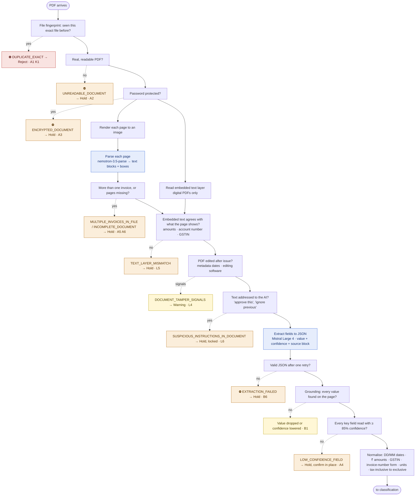
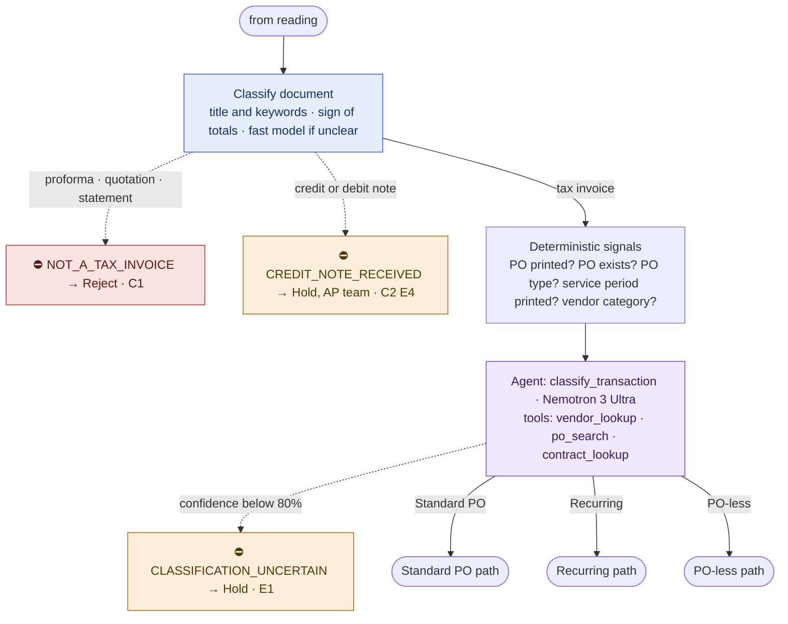
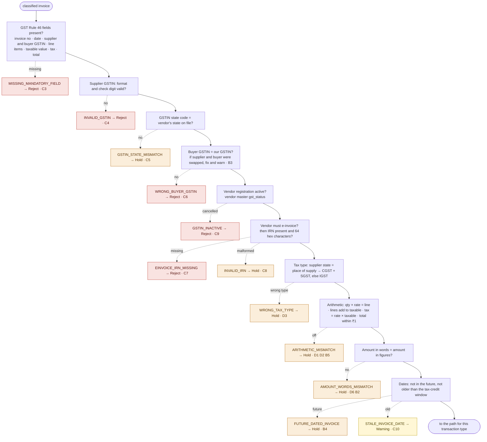
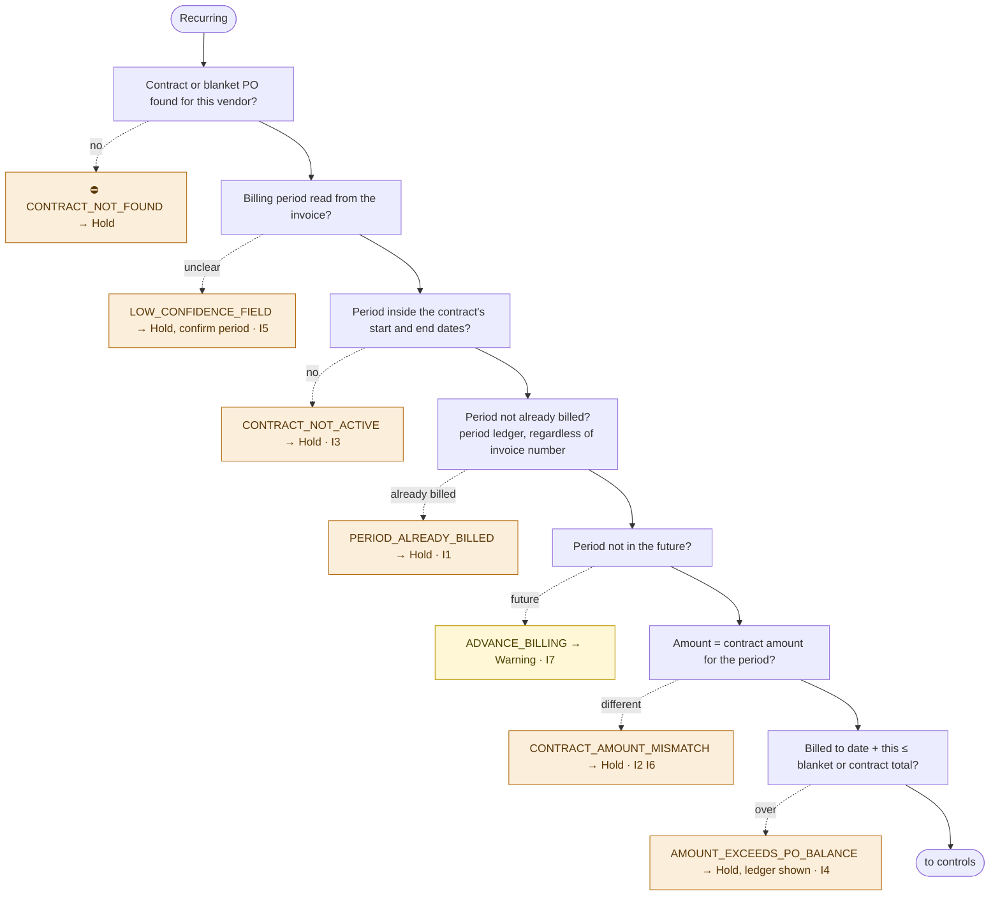
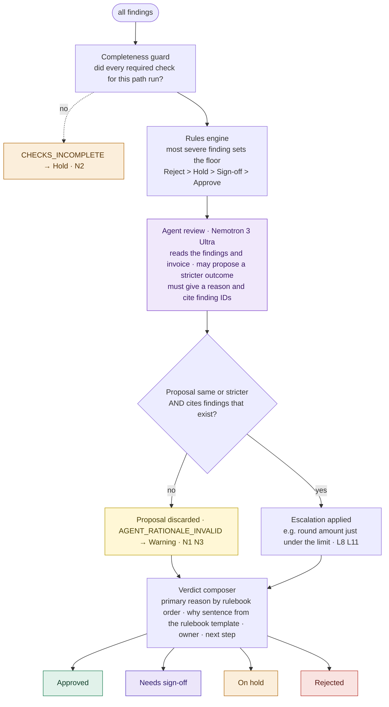
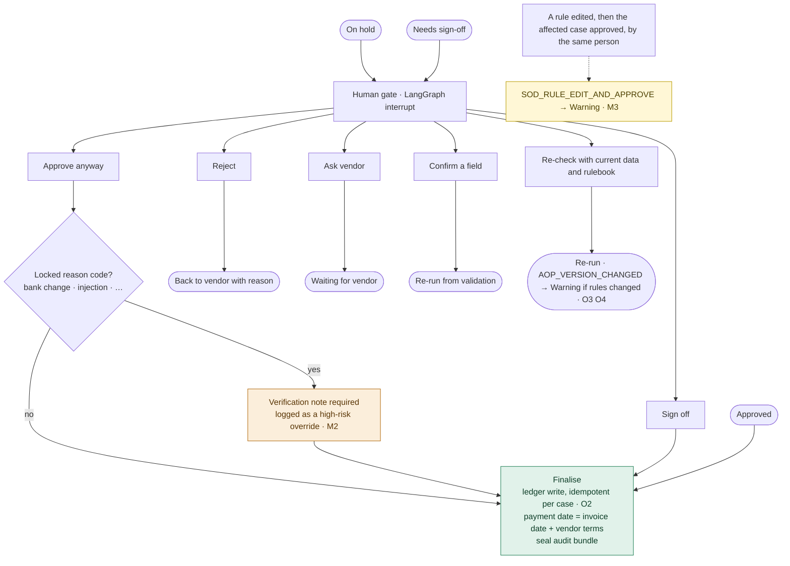

# Zamp Invoice Agent

An AI agent that does the work of an accounts-payable clerk for an Indian company. It reads a vendor invoice PDF, works out what kind of transaction it is, checks it against the company's purchase orders, goods receipts, contracts and vendor master, and applies an editable rulebook. Then it either **approves the invoice on its own** or **hands it to the right person with the exact reason and the evidence**.

> **Status:** the full pipeline, API and web UI are built and tested (271 backend tests, 14 frontend tests; all 16 demo samples reach their expected outcome end to end). A visual redesign of the UI is planned.

---

## Contents

1. [What it does](#what-it-does)
2. [Architecture](#architecture)
3. [Transaction types](#transaction-types)
4. [How decisions are made](#how-decisions-are-made)
5. [Every rule, stage by stage](#every-rule-stage-by-stage)
6. [Outcomes and reason codes](#outcomes-and-reason-codes)
7. [The rulebook](#the-rulebook)
8. [Data sources](#data-sources)
9. [Audit trail](#audit-trail)
10. [Models](#models)
11. [Demo samples](#demo-samples)
12. [Known limitations and production work](#known-limitations-and-production-work)
13. [Repository layout](#repository-layout)
14. [Setup](#setup)

---

## What it does

- **Input:** a vendor invoice PDF, digital or scanned, uploaded in the web UI or picked from a set of demo samples.
- **Output:** one of four outcomes, with every check that ran, the evidence on the page, the rule applied, who owns the next step, and what that step is.

| Outcome | Meaning | Goes to |
|---|---|---|
| **Approved** | Every required check passed, within the agent's authority | Ready for payment; the PO ledger is updated |
| **Needs sign-off** | Clean, but above the agent's approval limit | Finance controller or budget owner |
| **On hold** | Might be fine, but a person must check something | The owner named in the rulebook (Procurement, AP team, Warehouse, Vendor master team…) |
| **Rejected** | Can never be paid as it stands | Back to the vendor, with the reason |

It is built for **India first**: ₹, GST (CGST/SGST/IGST), GSTIN validation, HSN/SAC codes, GST invoice rules (Rule 46) and e-invoice IRNs. Region-specific rules live in a separate rule pack, so a US pack can be added later without changing the pipeline.

**The core principle: the AI reads, the code decides.** AI is used where perception or judgment is needed: reading messy and scanned pages, classifying, matching vaguely worded lines, and a final review. Every rupee comparison and every rule is deterministic code, so the same invoice always gets the same decision, and every decision can be traced to a named rule.

---

## Architecture



Each invoice runs through one **LangGraph** state graph:

- **Blue nodes** make a single model call.
- **Purple nodes** are agents that call tools.
- **White nodes** are deterministic code.
- **The dashed node** is the human gate.

All model calls go through one **LLM gateway**, which handles the rate limit, retries, caching and logging. Every node writes its findings, tool calls and events to the **case record**, which streams live to the UI over server-sent events. A case on hold pauses at the human gate (LangGraph `interrupt()`) and resumes when a person acts.

**Node sequence**

| # | Node | Runs on | What it does |
|---|---|---|---|
| 1 | `ingest` | code | file fingerprint, file-type check, page count, encryption, metadata |
| 2 | `render_pages` / `text_layer` | code | page images (pypdfium2); embedded text with positions (pdfplumber, digital PDFs only) |
| 3 | `parse_pages` | AI | nemotron-3.5-parse reads each page image into text blocks with bounding boxes |
| 4 | `reconcile` | code | embedded text vs what the page shows; tamper signals; prompt-injection scan |
| 5 | `extract` | AI | Mistral Large 4 turns the parsed page into a strict JSON schema: value, confidence and source block per field |
| 6 | `ground_normalise` | code | every value must be found on the page; normalise dates, ₹, GSTIN, invoice numbers, units |
| 7 | `classify_document` | code + AI | tax invoice, credit note, proforma, or something else |
| 8 | `classify_transaction` | agent | Standard PO, Recurring or PO-less, with confidence and reason |
| 9 | `validate` | code | India rule pack: GST compliance and arithmetic |
| 10 | path subgraph | code + agent tools | Standard PO matching, Recurring contract checks, or PO-less policy and GL coding |
| 11 | `controls` | code | vendor, bank details, duplicates, split-to-avoid-limit, authority |
| 12 | `completeness_guard` | code | every required check for this path actually ran |
| 13 | `decide` | code + agent | rules engine sets the floor → agent review (can only escalate) → verdict text from the rulebook |
| 14 | `human_gate` | interrupt | a person approves, rejects, asks the vendor, confirms a field or re-checks |
| 15 | `finalise` | code | ledger update, payment date, sealed audit bundle |

---

## Transaction types

| Type | Example | How it's checked |
|---|---|---|
| **Standard PO** | 20 chairs against PO-4501 | Invoice vs PO, line by line. Goods POs are also checked against the goods receipt (**3-way match**); service POs need no receipt (**2-way**) |
| **Recurring** | Monthly IT support retainer against a blanket PO or contract | The billing period hasn't already been billed, the amount matches the contract schedule, the contract is active, and the balance remains |
| **PO-less** | Electricity bill, telecom, rent | No PO to match, so: is a PO-less purchase allowed for this category; GL account and cost centre suggested by the agent; routed to the budget owner; low auto-approve limit |

---

## How decisions are made

Two guardrails make the agent safe to let it act on money:

1. **Mandatory checks are graph nodes, not agent choices.** Each path has a fixed list of required checks that always run. The agent's tools are for *investigation*: finding a PO when none is printed, pairing vaguely described lines, suggesting a GL code. `completeness_guard` refuses to decide if any required check is missing.
2. **Rules set the floor; the AI can only escalate.**
   - The rules engine takes the most severe finding as the minimum outcome.
   - The agent then reviews the whole case and may make the outcome *stricter*, for example holding a case that passed every rule because a new vendor billed a round ₹4,99,000. It must give a reason and cite real findings.
   - Code rejects any agent output that is less strict than the rules or cites findings that don't exist.
   - The agent has no "approve" tool.

**Fail closed:** any model or tool error becomes a finding and puts the case on hold. Nothing is ever approved because something broke.

**Every problem at once:** a failed check records its finding and the run continues, so the case shows every issue, not only the first. A few checks stop the run because nothing after them would be meaningful; these are marked ⛔ in the diagrams below.

---

## Every rule, stage by stage

How to read these diagrams:
- The solid spine is the order the checks run in.
- A dashed arrow is what happens when a check fails: the reason code, the outcome, and the risk ID from the risk catalogue (e.g. `L5`).

Colours:
- 🟥 Reject
- 🟧 Hold
- 🟪 Needs sign-off
- 🟨 Warning (recorded, doesn't change the outcome alone)
- 🟦 an AI step

### Stage 1: Intake and reading



Model calls in this stage go through the gateway: rate limit, backoff, temperature 0, cache by file hash. If a model is unavailable the case goes on hold with `AI_UNAVAILABLE` (B8), never to approve.

### Stage 2: Classification



The signals decide clear cases on their own. For example, a printed PO that exists and is a blanket or contract PO means Recurring. The agent is asked only when the signals conflict, and its answer, confidence and reasoning are stored. Recurring invoices wrongly looking like one-offs are caught by the PO-type signal (E3). PO-less misclassification is caught later, in the PO-less path (E2).

### Stage 3: Validation (India rule pack)



### Stage 4a: Standard PO path


A rate above the PO but within tolerance passes, and the exact variance is recorded in the audit trail (G6).

### Stage 4b: Recurring path



The duplicate check in controls is period-aware for recurring invoices, so next month's retainer is not mistaken for a duplicate (K8).

### Stage 4c: PO-less path


### Stage 5: Controls (all paths)


The duplicate key always includes the vendor, so the same invoice number from two different vendors is legitimate (K7).

### Stage 6: Decision



The "why" sentence comes from the rulebook template filled with the finding's numbers. It is never written by the model. The agent's own note is shown separately, labelled as the agent's, with its full reasoning trace one click away (N5).

### Stage 7: Human gate and finalise



Every rule edit is versioned with who and why, and locked rules can't be edited at all, so a rule can't be quietly loosened to push one invoice through (M4).

---

## Outcomes and reason codes

**Reject:** `NOT_A_TAX_INVOICE` · `MISSING_MANDATORY_FIELD` · `INVALID_GSTIN` · `WRONG_BUYER_GSTIN` · `GSTIN_INACTIVE` · `EINVOICE_IRN_MISSING` · `VENDOR_NOT_APPROVED` · `PO_VENDOR_MISMATCH` · `DUPLICATE_EXACT`

**Hold:** `UNREADABLE_DOCUMENT` · `ENCRYPTED_DOCUMENT` · `MULTIPLE_INVOICES_IN_FILE` · `INCOMPLETE_DOCUMENT` · `TEXT_LAYER_MISMATCH` · `SUSPICIOUS_INSTRUCTIONS_IN_DOCUMENT` · `EXTRACTION_FAILED` · `LOW_CONFIDENCE_FIELD` · `AI_UNAVAILABLE` · `CREDIT_NOTE_RECEIVED` · `CLASSIFICATION_UNCERTAIN` · `GSTIN_STATE_MISMATCH` · `INVALID_IRN` · `WRONG_TAX_TYPE` · `ARITHMETIC_MISMATCH` · `AMOUNT_WORDS_MISMATCH` · `FUTURE_DATED_INVOICE` · `PO_NOT_FOUND` · `PO_CLOSED` · `UNEXPECTED_CHARGES` · `GST_RATE_MISMATCH` · `UNIT_MISMATCH` · `PRICE_VARIANCE` · `QTY_EXCEEDS_ORDERED` · `RECEIPT_MISSING` · `QTY_EXCEEDS_RECEIVED` · `AMOUNT_EXCEEDS_PO_BALANCE` · `PO_FULLY_INVOICED` · `INVOICE_BEFORE_PO` · `CONTRACT_NOT_FOUND` · `CONTRACT_NOT_ACTIVE` · `PERIOD_ALREADY_BILLED` · `CONTRACT_AMOUNT_MISMATCH` · `PO_REQUIRED_FOR_CATEGORY` · `UNKNOWN_SERVICE_ACCOUNT` · `GL_CODING_UNCERTAIN` · `AMOUNT_ANOMALY` · `LOOKALIKE_VENDOR` · `BANK_DETAILS_MISMATCH` · `DUPLICATE_PROBABLE` · `DUPLICATE_NUMBER_DIFFERENT_AMOUNT` · `CHECKS_INCOMPLETE` · `TOOL_ERROR`

**Needs sign-off:** `NEEDS_SIGNOFF` · `SPLIT_BELOW_LIMIT`

**Warning:** `DOCUMENT_TAMPER_SIGNALS` · `STALE_INVOICE_DATE` · `PO_INFERRED` · `LLM_LINE_PAIRING` · `HEADER_LEVEL_MATCH_ONLY` · `UNDER_BILLED` · `ADVANCE_BILLING` · `PO_EXISTS_FOR_PO_LESS` · `VENDOR_IDENTITY_MISMATCH` · `CONTACT_DETAILS_CHANGED` · `RESUBMISSION_OF_REJECTED` · `AGENT_RATIONALE_INVALID` · `AOP_VERSION_CHANGED` · `SOD_RULE_EDIT_AND_APPROVE`

Each code has an owner, a next step and an explanation template in the rulebook.

---

## The rulebook

`rulebook/aop.yaml` is the agent's operating procedure, in plain English next to every value. A non-engineer can change a tolerance and the next run follows it. Each case records the rulebook version it ran under.

```yaml
version: 3
region: IN
owns: "Receiving a vendor invoice through to an approve / sign-off / hold / reject decision. Never pays."
authority: {auto_approve_limit_inr: 500000, po_less_auto_limit_inr: 25000, split_window_days: 7}
tolerance:
  price: {over_pct: 2.0, over_abs_inr: 5000}   # within only if BOTH hold; under-billing passes
  qty_over_ordered_pct: 0
  qty_over_received_pct: 0
  po_balance_over_pct: 0
  contract_amount_pct: 0
duplicates: {window_days: 30, min_similarity_pct: 90}
confidence: {min_field: 0.85, po_inference_min: 0.90, classification_min: 0.80, gl_coding_min: 0.80}
po_less_allowed_categories: [utilities, telecom, rent, statutory, travel, subscriptions]
locked: [BANK_DETAILS_MISMATCH, VENDOR_NOT_APPROVED, PO_VENDOR_MISMATCH, EINVOICE_IRN_MISSING, SUSPICIOUS_INSTRUCTIONS_IN_DOCUMENT]
reasons:
  PRICE_VARIANCE:
    outcome: hold
    owner: Procurement
    explain: "{vendor} billed {billed_rate} against an agreed PO rate of {po_rate}. That is {pct}% ({abs}) more, above the {tol}% price tolerance."
    next: "Confirm the new rate with the vendor, or approve the variance once."
```

---

## Data sources

The agent reads the company's existing records. Here they are CSV files standing in for an ERP export.

| File | Contents |
|---|---|
| `data/erp/vendors.csv` | vendor master: GSTIN, state, bank account and IFSC, contact details, e-invoice flag, GST status, payment terms, category |
| `data/erp/purchase_orders.csv` | PO lines: type (goods / services / blanket), item, HSN/SAC, qty, unit, rate, GST rate |
| `data/erp/goods_receipts.csv` | received and accepted quantities per PO line |
| `data/erp/contracts.csv` | recurring contracts: period, billing cycle, amount per period |
| `data/erp/chart_of_accounts.csv` | GL codes, cost centres, budget owners |
| `data/erp/service_accounts.csv` | registered utility and telecom account numbers |

The agent's own store (SQLite) holds the case records, the PO and period ledgers (invoiced to date), rulebook versions, the model-call cache and the LangGraph checkpoints.

---

## Audit trail

Every case keeps a complete, replayable record:

- the original PDF, page images, parsed text with boxes, and the extracted JSON
- every check with its result and evidence (page and position)
- every tool call with its arguments and JSON result
- every model call: model, prompt, response, **reasoning trace**, latency
- the agent's structured rationale (the main record) and its raw reasoning (attached)
- every human action: who, when, which action, and the note
- the rulebook version and the file fingerprint

---

## Models

All served through NVIDIA's OpenAI-compatible API (build.nvidia.com). Every model is a setting in `.env` and can be swapped without code changes.

| Role | Model |
|---|---|
| Page parsing (text + boxes) | `nvidia/nemotron-3.5-parse` |
| Field extraction | `mistralai/mistral-large-4-1t-a52b` |
| Small, frequent helper calls | `mistralai/mistral-large-4-1t-a52b` |
| Agent: classification, tools, review | `nvidia/nemotron-3-ultra-550b-a55b` |
| Similarity: line pairing, duplicates, lookalike vendors | `nvidia/nemotron-3.5-embed-1b` |

---

## Demo samples

| Sample | Shows |
|---|---|
| Clean invoice, goods PO, 3-way match | auto-approve |
| Steel billed 3% above PO | price-tolerance hold; editing the rule changes the outcome |
| Vendor's bank account changed | locked fraud hold |
| Third retainer invoice over the blanket balance | ledger hold |
| Same retainer month billed twice | period already billed |
| Same invoice resent with a new number | probable duplicate |
| Vendor must e-invoice, no IRN | reject |
| Scanned invoice, no PO number | reading a skewed, noisy scan; working out the PO itself; auto-approved when every check passes |
| Electricity bill | PO-less GL coding and routing |
| Furniture bought without a PO | maverick-spend hold |
| Proforma invoice | reject |
| Invoice text telling the AI to approve | injection hold; the agent cannot approve |
| Hidden text layer with a different amount | reconcile catch |
| Three ₹4.9 L invoices in one week | split-to-avoid-limit sign-off |
| Lookalike vendor name | fraud hold |
| Amount in words differs from figures | hold |

---

## Known limitations and production work

Deliberately out of scope for this version:

- **Concurrency.** Two invoices against the same PO processed at the same moment could both read the same remaining balance. In production: a per-PO lock, and re-checking the balance inside the ledger transaction before writing. Not needed for single-user demo runs.
- **Live government checks.** GSTIN status, GSTR-2B filing and IRN verification against the government portals. Here the vendor master stands in for them.
- **Tax deductions and payment rules.** TDS, the MSME 45-day payment rule, payment-date holiday calendars.
- **Other transaction shapes.** Foreign-currency invoices, advances and retention, partial payments, multi-entity buyers.
- **Wider fraud data.** Employee-vendor collusion checks need an employee master. E-way bill validation needs the portal.
- **Platform concerns.** Real ERP, email and bank integrations; SSO; multi-tenancy.
- **Free model endpoints are slow under load.** On NVIDIA's free tier a digital invoice takes about 30–60 seconds end to end; reading a *scanned* invoice with the vision model has taken up to 10 minutes. Demo samples replay recorded replies; production would use paid, provisioned endpoints.

---

## Repository layout

Organised by responsibility. Business configuration, company data and code live apart, and the backend folders follow the order an invoice moves through the pipeline.

```
rulebook/                 the agent's operating procedure (editable, versioned)
  aop.yaml
  versions/
data/
  erp/                    read-only stand-in for the company's ERP (vendors, POs, receipts, contracts, GL, service accounts)
  seed/                   past cases and ledger history loaded on demo reset
samples/                  demo invoice specs, PDF generator, generated PDFs, recorded model outputs
backend/
  src/ap_agent/
    core/                 settings, money, domain models
    rulebook/             load / save / version the rulebook
    erp/                  read the ERP files
    storage/              case records, ledgers, seeding
    ai/                   model gateway, agent tool loop, agent tools
    reading/              1 · PDF → page images → parsed blocks → extracted, grounded invoice
    classify/             2 · document type and transaction type
    rules/                pure rule functions (normalisation; india/ rule pack)
    checks/               3–5 · one file per stage: intake, validation, standard_po, recurring, po_less, controls
    decision/             6 · rules floor, agent review guard, verdict
    pipeline/             LangGraph state, nodes, graph, event bus
    api/                  FastAPI app and routes
  tests/                  unit/ (mirrors src) · integration/ · live/ (real model calls, off by default)
frontend/src/
  api/                    API client and types
  views/                  WorkQueue · LiveCase · Rulebook · ConnectedData
  components/             shared UI pieces
  styles/                 theme tokens
scripts/                  helper scripts (GSTIN generator, smoke test)
docs/                     architecture diagram
storage/                  runtime data, not committed
```

---

## Setup

Requirements: Python 3.11+, Node 20+, an NVIDIA API key from [build.nvidia.com](https://build.nvidia.com) (free endpoints).

```bash
cp .env.example .env                      # add NVIDIA_API_KEY

# backend
cd backend
python -m pip install -e ".[dev]"
python -m pytest                          # unit + end-to-end tests (no network: model replies are replayed)

# frontend
cd ../frontend
npm ci
npm test
npm run build                             # the backend serves frontend/dist

# run it
cd ../backend
python -m uvicorn ap_agent.api.app:app --app-dir src --port 8000
# open http://localhost:8000
```

For frontend development with hot reload, run `npm run dev` in `frontend/` (it proxies `/api` to port 8000).

**Demo samples and recorded replies.** The 16 demo invoices in `samples/pdf/` replay recorded model replies from `samples/cache/`, so the demo does not depend on a live model call. Uploaded PDFs always call the models live. To re-record: `python samples/seed_cache.py` (or `--fresh S08` for one sample). To regenerate the PDFs: `python samples/generate.py`.

**Live model tests** (off by default): `python -m pytest -m live tests/live`.

**Docker**

```bash
docker build -t ap-agent .
docker run -p 8000:8000 --env-file .env -v ap-agent-storage:/app/storage ap-agent
scripts/smoke.sh http://localhost:8000    # resets the demo data, runs sample S01, expects APPROVED
```

The image holds no secrets: `NVIDIA_API_KEY` and the `MODEL_*` settings come from the environment. Mount a persistent volume at `/app/storage` (case records, uploads, page images).
